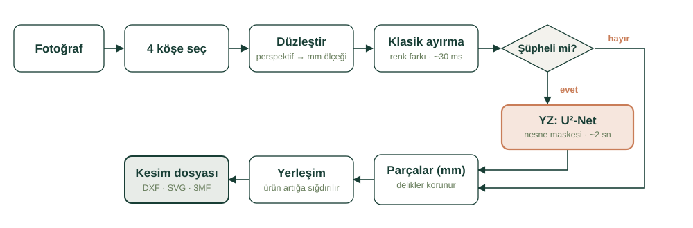
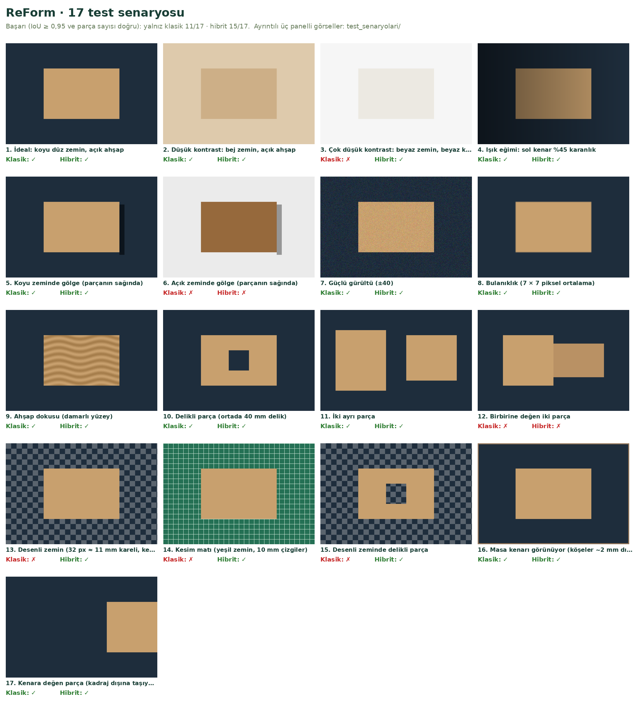

# ReForm

**Elindeki artık malzemenin fotoğrafını çek, ondan hangi ürünü kesebileceğini gör, kesim dosyasını indir.**

ReForm, atölyede biriken düzensiz şekilli artık levhaları (kontrplak, MDF, akrilik, karton, keçe, mantar…) fotoğraftan milimetre ölçeğinde ölçen bir uygulama. Bu ölçüyle seçilen ürünün parçalarını artık malzemenin üzerine yerleştiriyor ve lazer kesim / CNC için DXF veya SVG, 3D baskı için 3MF dosyası üretiyor. Tamamen tarayıcıda çalışıyor; internet ve kurulum gerekmiyor.

Malzemeyi zeminden ayırmak için **hibrit bir yöntem** kullanıyor: hızlı klasik görüntü işleme her zaman çalışıyor; sonuç şüpheliyse uygulamaya gömülü **YZ modeli (U²-Net)** devreye giriyor.

**Canlı uygulama (kurulum gerekmez):** https://cranketz.github.io/ReForm/ · Kaynak: https://github.com/cranketz/ReForm

> Uygulamalı Yapay Zeka ve Görüntü İşlemeye Giriş — proje sunumu (18 Kasım 2026)

---

## 1. Problem ve hedef kullanıcı

- **Problem:** Lazer kesim ve CNC atölyelerinde kesimden sonra düzensiz şekilli artık parçalar kalıyor. Bunları elle ölçüp bir ürünün sığıp sığmadığını denemek zahmetli olduğu için çoğu çöpe gidiyor.
- **Hedef kullanıcı:** Okul ve üniversite atölyeleri, maker'lar, küçük lazer kesim işletmeleri.
- **Kullanım anı:** Kullanıcı yeni bir levha açmadan önce elindeki artıkları düz bir zemine koyuyor, fotoğraflıyor ve uygulamaya hangi ürünün sığdığını soruyor.
- **Problemin önemine kanıt:**
  - Mobilya üretiminde ham maddenin genellikle %10–20'si ahşap atığı olarak kayboluyor ([Gomes vd., Frontiers in Built Environment, 2025](https://www.frontiersin.org/articles/10.3389/fbuil.2025.1623281/full)).
  - ABD'de 2018'de evsel atığa 18,1 milyon ton ahşap karıştı; bunun 12,2 milyon tonu çöp sahasına gitti ([EPA, Wood: Material-Specific Data](https://www.epa.gov/facts-and-figures-about-materials-waste-and-recycling/wood-material-specific-data)).

### Benzer çözümler ve fark

| Çözüm | Ne yapıyor | ReForm'un farkı |
|---|---|---|
| Glowforge kamera | Makinedeki malzemenin kamera görüntüsü üzerine tasarımı elle yerleştirme ([Glowforge destek](https://support.glowforge.com/hc/en-us/articles/360033633714-alignment)) | Makineden bağımsız; yerleşim otomatik |
| Deepnest / SVGnest | Parçaları **dijital olarak çizilmiş** levhalara yerleştiriyor | Levhanın şeklini **fotoğraftan** çıkarıyor; düzensiz artıkla çalışıyor |
| CutList Optimizer | Dikdörtgen levha ve parçalar için kesim listesi | Düzensiz şekil, delikli parça, mm ölçekli kontur |
| Genel arka plan silme araçları (rembg vb.) | Nesneyi maskeliyor | Maskeyi mm ölçeğine çeviriyor; yerleşim ve kesim dosyası üretiyor |

---

## 2. Çalıştırma

| Ne | Nasıl |
|---|---|
| Uygulama | `ReForm_MVP.html` dosyasını Chrome ya da Edge ile açın (testler Chrome’da yapıldı). Kurulum ve internet gerekmez. Dosya ~21 MB çünkü YZ modeli ve çalıştırıcısı içinde. |
| Fotoğraf yoksa | Açılış ekranında **"Fotoğrafın yok mu? Demo dene"** düğmesine basın (yapay demo malzemesi). |
| Ayırma yöntemini seçmek | **Malzemeni ekle → Fotoğraf ayarları → Malzemeyi ayırma yöntemi:** Otomatik (varsayılan) · Yalnız klasik · Her zaman YZ |
| Klasik yöntem testi | `node tests/goruntu_isleme_testi.js --md TEST_SONUCLARI.md` (Node 18+, ek paket yok) |
| Hibrit (uygulama içi YZ) testi | `pip install playwright pillow numpy` → `playwright install chromium` → `node tests/goruntu_isleme_testi.js --export tests/senaryolar` → `python tests/hibrit_testi.py tests/senaryolar --md HIBRIT_TEST_SONUCLARI.md` |
| Hazır model karşılaştırması | `pip install "rembg[cpu]" pillow numpy` → `python tests/yz_karsilastirma.py tests/senaryolar --md YZ_KARSILASTIRMA.md` |

### Dosya yapısı

```
ReForm/
├── ReForm_MVP.html            Uygulamanın tamamı (tek dosya, çevrim dışı, YZ modeli gömülü)
├── README.md                  Bu dosya
├── TEST_SONUCLARI.md          Klasik yöntem testinin çıktısı
├── HIBRIT_TEST_SONUCLARI.md   Klasik / hibrit / YZ karşılaştırması (uygulamanın içinde ölçüldü)
├── YZ_KARSILASTIRMA.md        Klasik yöntem ile hazır U²-Net modelleri (rembg) karşılaştırması
├── docs/                      Akış şeması ve test özeti görseli
├── test_senaryolari/          17 test senaryosunun görselleri (görüntü · klasik · hibrit)
└── tests/
    ├── goruntu_isleme_testi.js  HTML içindeki ReformVision modülünü doğrudan test eder
    ├── hibrit_testi.py          Uygulamayı Chrome'da açıp ReformAI (hibrit) yöntemini ölçer
    ├── yz_karsilastirma.py      Aynı senaryoları rembg (U²-Net) ile çalıştırır
    ├── test_fotografi_uret.py   Gerçekçi, ölçüsü bilinen test fotoğraflarını üretir
    └── senaryo_gorselleri.py    17 senaryonun görsellerini üretir
test_fotograflari/
├── 01…10_*.jpg                Gerçekçi test fotoğrafları (300 × 200 mm pano üzerinde)
└── CEVAP_ANAHTARI.md          Gerçek ölçüler ve uygulamanın sonuçları
```

---

## 3. Sistem akışı



**Şüpheli** = hiç parça yok · zemin neredeyse görünmüyor · çok sayıda küçük parça · alanı ağ gibi kaplayan desen (kesim matı). Bu durumda YZ devreye girer; delikler klasik sonuçtan geri alınır.

Kodda klasik görüntü işleme `ReformVision` modülünde (HTML içindeki ilk büyük `<script>` bloğu):

| Adım | Fonksiyon | Açıklama |
|---|---|---|
| Perspektif düzeltme | `warp(image, corners, outW, outH)` | 4 köşeden 8 bilinmeyenli doğrusal denklem kurup (Gauss eliminasyonu, `solveLinear`) homografiyi çözer; her çıktı pikselini bilineer enterpolasyonla örnekler. Köşe sırası ters seçilirse hata verir. |
| Arka plan tahmini | `estimateBackground` | Görüntünün 4 kenarından örnek alır; rengin ortancası arka plan sayılır. Kenarlardaki renk yayılımına göre eşik otomatik yükseltilir (en fazla 2 katı). |
| Bölütleme | `analyze` | Her pikselin arka plana RGB uzaklığı eşikten büyükse malzeme sayılır. Doygun renkli zeminde ton (hue) farkı 18°'den azsa ışık değişimine rağmen zemin kabul edilir. |
| Parça bulma | `analyze` (flood fill) | 4-komşuluk bağlı bileşenler; 60 mm²'den küçük bölgeler gürültü sayılıp silinir. |
| Kontur | `traceBoundary`, `simplifyLoop` | Piksel kenarlarını izleyerek dış sınırı ve delikleri ayrı ayrı çıkarır (dışbükey zarf değil); Douglas-Peucker ile sadeleştirir. |
| Fotoğraf uyarıları | `diagnostics` (ReformProduction) | Sınır bulunamadı, zemin az görünüyor, malzeme kenara değiyor, çok sayıda küçük parça (desenli zemin). |

YZ bölümü `ReformAI` modülünde (ana uygulama kodundan hemen önceki `<script>` bloğu):

| Adım | Fonksiyon | Açıklama |
|---|---|---|
| Model yükleme | `session()` | Gömülü wasm ve modeli (base64) ilk kullanımda bir kez açar; onnxruntime-web tek iş parçacığıyla çalışır. Açılıştan 1,5 sn sonra arka planda önceden yüklenir (`warmup`). |
| YZ maskesi | `segment(image)` | Görüntüyü 320 × 320'ye küçültür, ImageNet ortalama / sapmasıyla normalleştirir, modeli çalıştırır; çıkan olasılık haritasını asıl boyuta büyütüp 0,5 eşiğiyle ikili maskeye çevirir. |
| Karar kuralı | `needsFallback(scene)` | Klasik sonuçta parça yoksa, 12'den fazla parçanın 8'den fazlası 400 mm²'den küçükse veya zemin neredeyse hiç görünmüyorsa YZ'ye geçer. |
| Delik kurtarma | `restoreHoles(...)` | YZ deliği kapatma eğiliminde. Klasik maskede görüntü kenarına değmeyen ve YZ maskesinin içinde kalan zemin bölgeleri delik sayılıp çıkarılır; deliğin içinde kalan desen kalıntıları silinir. |
| Hibrit akış | `analyze(image, options, mode)` | `auto` / `classic` / `ai` moduna göre yukarıdaki adımları birleştirir; sonuç yine `ReformVision.analyze` ile kontura ve mm'ye çevrilir. |

---

## 4. YZ'nin rolü ve neden hibrit yöntem?

**YZ'nin görevi: bölütleme.** Fotoğraftaki malzemeyi (öne çıkan nesneyi) zeminden piksel düzeyinde ayırmak. Kullanılan model U²-Net'in küçük sürümü (u2netp, 4,6 MB). Bu, "öne çıkan nesne tespiti" için eğitilmiş, hazır ve açık kaynak bir model. Modeli yeniden eğitmedik; ön işlemeyi, karar kuralını ve delik kurtarmayı problemimize göre tasarladık.

**Neden basit kurallar yetmiyor?** Klasik yöntem yalnız renk farkına bakıyor. Malzeme zeminle aynı renkteyse (beyaz zeminde beyaz karton) ya da zemin desenliyse (kareli kesim matı) başarısız oluyor. Bu iki durumda nesnenin ne olduğunu "anlayan" bir model gerekiyor.

**Neden yalnız YZ değil?** Önce hazır modelleri klasik yöntemle aynı 17 test görüntüsünde karşılaştırdık ([`YZ_KARSILASTIRMA.md`](YZ_KARSILASTIRMA.md)):

| | Klasik (ReForm) | U²-Net küçük (u2netp) | U²-Net (u2net) |
|---|---|---|---|
| Başarılı senaryo (17 içinde) | 11 | 12 | 12 |
| Model boyutu | yok | 4,6 MB | 176 MB |
| Delikli parçanın deliğini korur | **evet** | hayır (IoU 0,89) | hayır (IoU 0,89) |
| Beyaz zeminde beyaz karton | başarısız | **evet** | **evet** |
| Desenli zemin, kesim matı | başarısız | **evet** | **evet** |
| Koyu zeminde gölge | **doğru** | başarısız | başarısız |

İki yaklaşım eşit sayıda senaryoda başarılı, ama farklı yerlerde başarısız oluyor. ReForm için en kritik hata **deliğin kapanması**: delik kapanırsa yerleşim algoritması ürün parçasını deliğin üstüne koyar ve kesim bozuk çıkar.

**Karar: hibrit yöntem.** İki yaklaşımın güçlü yanlarını birleştirdik. Sonuçlar uygulamanın içinde ölçüldü ([`HIBRIT_TEST_SONUCLARI.md`](HIBRIT_TEST_SONUCLARI.md)):

| Mod | Başarılı senaryo | Ortalama IoU | Ortanca süre |
|---|---|---|---|
| Yalnız klasik | 11 / 17 | 0,849 | ~25 ms |
| Her zaman YZ (+ delik kurtarma) | 13 / 17 | 0,983 | ~1,9 sn |
| **Otomatik (hibrit, varsayılan)** | **15 / 17** | **0,989** | **~30 ms** (YZ yalnız 4 senaryoda çalıştı, ~2 sn) |

**Model seçimi:** Büyük U²-Net (176 MB) küçük modelden daha başarılı değildi ve ~2,4 kat yavaştı; tek dosyalık, internetsiz bir uygulamaya gömülemeyecek kadar büyük. Bu yüzden küçük model (u2netp) seçildi.

**Tasarım kısıtları:**
- **Çevrim dışı:** Model ve çalıştırıcı (onnxruntime-web, WebAssembly) HTML'in içinde. Uygulama internetsiz çalışıyor, demo sırasında bağlantı kesilse de sorun olmuyor.
- **Maliyet:** API ücreti yok, sunucu yok.
- **Donanım:** Sıradan bir dizüstü bilgisayarın işlemcisinde çalışıyor; ekran kartı gerekmiyor.
- **Bedeli:** Dosya ~0,5 MB'tan ~21 MB'a çıktı. YZ çalıştığında ~2 sn bekleme oluyor; model ilk kez yüklenirken ~1–3 sn daha.

---

## 5. Ayarlar ve gerekçeleri

| Ayar | Değer | Gerekçe |
|---|---|---|
| Yükleme çözünürlüğü | En uzun kenar 1400 px | Telefon fotoğrafları (4000 px+) tarayıcıda yavaş ve bellek yoğun. 1400 px, 4 köşeyi hassas seçmeye yetiyor. |
| Düzeltilmiş görüntü | En uzun kenar 900 px | 300 mm alanda 3 piksel/mm (piksel ≈ 0,33 mm). Lazer kesim payı genelde 0,1–0,3 mm olduğu için yeterli; analiz ~150 ms sürüyor. |
| Arka plan örnekleme | kenardan %3 içeriden | Köşeler birkaç mm dışarıdan seçilince en dış satırlarda masa görünüyor; tam kenardan örnek alınırsa arka plan rengi yanlış çıkıp parça hiç bulunamıyordu (test fotoğraflarında 10'da 3). |
| Kenar şeridi | %1,5 (~4,5 mm) yok sayılır | Köşe hatasıyla görünen masa / pano kenarı malzeme sanılmasın. Kenara çok yakın parça bu kadar küçük ölçülür: kesim için güvenli taraf. |
| Renk eşiği (RGB uzaklığı) | 45 (ayarlanabilir 20–130) | En büyük RGB uzaklığı ~441. 45, gürültüyü (±40 test) ve ışık eğimini geçiriyor, bej zemin–açık ahşap farkını hâlâ yakalıyor. Kenar yayılımı yüksekse otomatik artıyor. |
| Ton toleransı | 18° (zemin doygunluğu > 0,25 ise) | Renkli zeminde gölge parlaklığı değiştirir ama tonu değiştirmez; gölgenin malzeme sanılmasını önler. |
| En küçük parça | 60 mm² (~8 × 8 mm) | Bundan küçük bir artıktan anlamlı bir parça kesilemez; toz, leke ve gürültüyü temizler. |
| Kontur sadeleştirme | 0,6 piksel (≈ 0,2 mm) | Kesim dosyasını küçültür; hata kesim payının altında kalır. |
| YZ modeli | u2netp (4,6 MB) | Büyük model (176 MB) testlerde daha başarılı değildi, ~2,4 kat yavaştı ve tek dosyaya gömülemeyecek kadar büyük. |
| YZ girdi boyutu | 320 × 320 | Modelin eğitildiği boyut. Ön işleme (en parlak değere bölme, ImageNet ortalama/sapma) rembg ile aynı tutuldu; böylece Python'daki karşılaştırma ile uygulama aynı modeli aynı şekilde çalıştırıyor. |
| YZ maske eşiği | 0,5 | Olasılık haritasının ortası; rembg'nin varsayılanı. |
| YZ'ye geçiş kuralı | parça yok · zemin < %5 · 12+ parçanın 8+'sı < 400 mm² · alanın %90'ına yayılan ağ gibi bölge (kesim matı çizgileri) | Uygulamanın fotoğraf uyarılarıyla aynı ölçütler. Normal fotoğraflarda YZ hiç çalışmıyor, uygulama hızlı kalıyor. |
| İş parçacığı | 1 | Dosya doğrudan açıldığında (file://) tarayıcı çoklu iş parçacığına izin vermiyor. |

---

## 6. Test sonuçları



Her senaryonun test görüntüsü, klasik ve hibrit sonucu yan yana: [`test_senaryolari/`](test_senaryolari) (yeşil: doğru bulunan, kırmızı: yanlışlıkla malzeme sanılan, mavi: kaçırılan).

Ayrıntılar: [`TEST_SONUCLARI.md`](TEST_SONUCLARI.md) (klasik yöntem) ve [`HIBRIT_TEST_SONUCLARI.md`](HIBRIT_TEST_SONUCLARI.md) (uygulamanın içinde klasik / hibrit / YZ). Testler uygulamadaki kodun kendisini çalıştırır.

- **Yapay senaryolar (17):** Yalnız klasik 11/17, her zaman YZ 13/17, **otomatik hibrit 15/17** (IoU ≥ 0,95 ve parça sayısı doğru). Hibritte ortalama IoU 0,989; ortanca süre ~30 ms, YZ çalıştığında ~2 sn.
- **Gerçekçi test fotoğrafları (10):** Eğik açı, doku, gölge, gürültü ve JPEG içeren, ölçüsü bilinen fotoğraflar ([`test_fotograflari/CEVAP_ANAHTARI.md`](test_fotograflari/CEVAP_ANAHTARI.md)). Otomatik mod 8/10 doğru; doğru olanlarda **ölçü hatası en fazla 1,7 mm**. Kalan 2'si bilerek konan zor durumlar (açık zeminde gölge, değen parçalar).
- **Bu testlerle bulunan ve düzeltilen hata:** İlk sürüm arka plan rengini görüntünün en dış satırlarından alıyordu. Köşeler tam ya da 1 mm dışarıdan seçildiğinde masa da örneğe karışıyor, koyu zeminde bile parça bulunamıyordu (10 fotoğrafın 3'ünde 0 parça). Örnekleme kenardan %3 içeriye alındı ve kenar şeridi yok sayıldı; köşe ±4 mm şaşsa da parça doğru bulunuyor (senaryo 16, eski sürümde IoU 0,000 → yeni sürümde 1,000).
- **Eğik çekim testi:** Yamuk açıdan çekilmiş 150 × 100 mm'lik parça düzeltmeden sonra **0,0 mm en / boy hatası**, %0,6 alan hatasıyla ölçüldü.
- **Klasik yöntemin başarısız olduğu, hibritin çözdüğü durumlar:**
  1. *Beyaz zeminde beyaz karton:* Renk farkı eşiğin altında → klasik yöntem parça bulamıyor. Hibrit: YZ ile bulundu, IoU 1,000.
  2. *Desenli zemin (kesim matı):* Kareler malzeme sanılıyor → klasik yöntem 184 parça buluyor. Hibrit: tek parça, IoU 0,994.
  3. *Desenli zeminde delikli parça:* Klasik yöntem 187 parça buluyor; YZ tek başına deliği kapatıyor. Hibrit: YZ şekli buldu, delik klasik maskeden geri alındı, IoU 0,976.
- **Hibritin de başarısız olduğu durumlar:**
  1. *Açık zeminde gölge:* Gri gölge malzemeye ekleniyor → alan %6–7 fazla ölçülüyor. YZ de gölgeyi nesneye katıyor.
  2. *Birbirine değen iki parça:* Tek parça sayılıyor. Parçalar arasında birkaç mm boşluk bırakılmalı.
- **YZ kenar payı:** YZ maskesi kenarlarda ~1 mm taşabiliyor; YZ kullanıldığında uygulama "parça sınırlarını kontrol et" uyarısı veriyor.

### Gerçek fotoğraf testi (yapılmadı)

Kullanıcıların telefonla çektiği gerçek fotoğraflarla sistematik bir ölçüm testi henüz yapılmadı. Testler, gerçek ölçüsü kesin bilinen yapay senaryolarla ve gerçekçi üretilmiş fotoğraflarla yapıldı. Planlanan test: A4 kağıt (297 × 210 mm) üzerinde banka kartı (standart ölçü 85,6 × 54 mm) ve cetvelle ölçülmüş artık parçalar; tepeden ve eğik açıdan, farklı ışık ve zeminlerde.

---|---|---|---|---|---|---|---|---|
| 1 | | | | | | | | |
| 2 | | | | | | | | |
| 3 | | | | | | | | |

---

## 7. Gizlilik, etik ve güvenlik

- **Fotoğraf cihazdan çıkmaz.** Uygulamada hiç ağ isteği yok. YZ modeli de uygulamanın içinde ve tarayıcıda çalışıyor; fotoğraf hiçbir sunucuya veya YZ hizmetine gönderilmiyor. (Testte doğrulandı: sayfa açılıp YZ çalıştırıldığında dışarıya tek istek gitmedi.)
- Tarayıcıda yalnız ayarlar, özel ürün şablonları, artık parça kayıtları ve test notları saklanıyor (`localStorage`). Fotoğraf saklanmıyor.
- Fotoğrafta el, yüz veya kişisel eşya görünürse bunlar da "malzeme" sanılabilir. YZ modeli "öne çıkan nesne" bulmak için eğitildiğinden özellikle insanları ve eşyaları nesne sayabilir. Kullanıcıya yalnız malzemeyi çekmesi önerilir.
- **Güvenlik sınırı:** Uygulama yerleşimi ve geometriyi kontrol ediyor, **yük dayanımını hesaplamıyor**. Kesimden önce ölçüyü bir numuneyle doğrulamak gerekiyor.

## 8. Sınırlılıklar

- Klasik yöntem zeminin düz ve tek renkli olduğunu varsayıyor; desenli veya malzemeyle aynı renkteki zeminde YZ'ye geçiliyor, bu da ~2 sn bekleme ve kenarlarda ~1 mm taşma demek.
- Testler yapay ve gerçekçi üretilmiş görüntülerle yapıldı; gerçek kullanıcı fotoğraflarıyla sistematik ölçüm testi henüz yok.
- YZ modeli genel amaçlı; artık levha fotoğraflarıyla yeniden eğitilmedi. Kendi fotoğraflarımızdan etiketli bir veri seti toplanırsa model ince ayarla (fine-tuning) iyileştirilebilir.
- Açık zemindeki gölgeleri ne klasik yöntem ne YZ ayırabiliyor; dağınık ışık veya koyu zemin önerilir.
- Kullanıcının 4 köşeyi doğru seçmesi gerekiyor. Birkaç mm'lik köşe hatası artık parçayı kaybettirmiyor ama ölçüye yansıyor (300 mm'lik alanda 4 mm dışarıdan seçilen köşeler ölçüyü ~%2–3 küçültür).
- Telefon lensinin bükmesi (lens distorsiyonu) düzeltilmiyor; kenarlara yakın parçalarda küçük hata olabilir.
- Değen parçalar tek parça sayılıyor; parlak / yansıtıcı malzemelerde (akrilik, metal) yansıma sorun çıkarabilir.

## 9. Hazır kod ve proje katkısı

| Bölüm | Kaynak |
|---|---|
| Earcut 2.2.4 (üçgenleme, 3D önizleme) | Mapbox, ISC lisansı — HTML içinde lisans notuyla |
| Görüntü işleme (`ReformVision`), geometri ve yerleşim, ürün şablonları, kesim dosyası üretimi, 3D önizleme, arayüz | Projenin kendi kodu |
| onnxruntime-web 1.17.3 (YZ modelini tarayıcıda çalıştırır) | Microsoft, MIT lisansı — HTML içinde gömülü, lisans notuyla |
| U²-Net küçük model (u2netp.onnx) | Qin vd. 2020, Apache-2.0 lisansı; ONNX dosyası rembg projesinden — HTML içinde gömülü, kaynak notuyla |
| YZ entegrasyonu (`ReformAI`): ön işleme, karar kuralı, delik kurtarma, hibrit akış | Projenin kendi kodu |
| Testler (`tests/`) | Projenin kendi kodu; karşılaştırmada `rembg` (MIT) ve U²-Net modelleri kullanılıyor |
